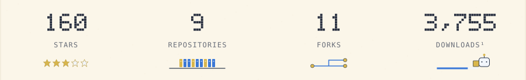
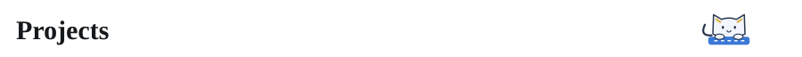
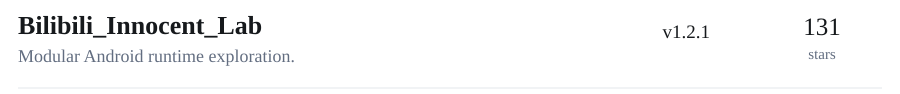
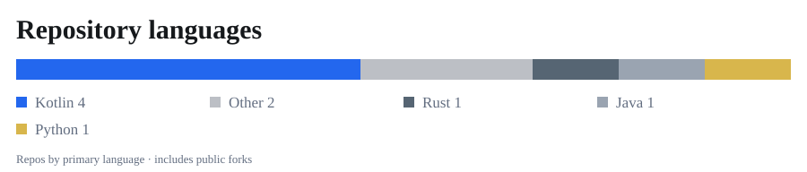
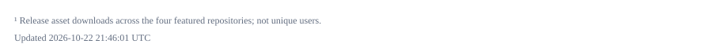

<picture>
  <source media="(max-width: 600px) and (prefers-color-scheme: dark)" srcset="assets/header-mobile-dark.svg">
  <source media="(max-width: 600px)" srcset="assets/header-mobile-light.svg">
  <source media="(prefers-color-scheme: dark)" srcset="assets/header-dark.svg">
  
</picture>

<picture>
  <source media="(max-width: 600px) and (prefers-color-scheme: dark)" srcset="assets/stats-mobile-dark.svg">
  <source media="(max-width: 600px)" srcset="assets/stats-mobile-light.svg">
  <source media="(prefers-color-scheme: dark)" srcset="assets/stats-dark.svg">
  
</picture>

<picture>
  <source media="(max-width: 600px) and (prefers-color-scheme: dark)" srcset="assets/projects-title-mobile-dark.svg">
  <source media="(max-width: 600px)" srcset="assets/projects-title-mobile-light.svg">
  <source media="(prefers-color-scheme: dark)" srcset="assets/projects-title-dark.svg">
  
</picture>

<a href="https://github.com/jichuo1/Bilibili_Innocent_Lab">
<picture>
  <source media="(max-width: 600px) and (prefers-color-scheme: dark)" srcset="assets/project-Bilibili_Innocent_Lab-mobile-dark.svg">
  <source media="(max-width: 600px)" srcset="assets/project-Bilibili_Innocent_Lab-mobile-light.svg">
  <source media="(prefers-color-scheme: dark)" srcset="assets/project-Bilibili_Innocent_Lab-dark.svg">
  
</picture>
</a>

<a href="https://github.com/jichuo1/LumenCoacervationEngine">
<picture>
  <source media="(max-width: 600px) and (prefers-color-scheme: dark)" srcset="assets/project-LumenCoacervationEngine-mobile-dark.svg">
  <source media="(max-width: 600px)" srcset="assets/project-LumenCoacervationEngine-mobile-light.svg">
  <source media="(prefers-color-scheme: dark)" srcset="assets/project-LumenCoacervationEngine-dark.svg">
  
</picture>
</a>

<a href="https://github.com/jichuo1/SplashScreenAdvanced">
<picture>
  <source media="(max-width: 600px) and (prefers-color-scheme: dark)" srcset="assets/project-SplashScreenAdvanced-mobile-dark.svg">
  <source media="(max-width: 600px)" srcset="assets/project-SplashScreenAdvanced-mobile-light.svg">
  <source media="(prefers-color-scheme: dark)" srcset="assets/project-SplashScreenAdvanced-dark.svg">
  
</picture>
</a>

<a href="https://github.com/jichuo1/GlobalTokenTracker">
<picture>
  <source media="(max-width: 600px) and (prefers-color-scheme: dark)" srcset="assets/project-GlobalTokenTracker-mobile-dark.svg">
  <source media="(max-width: 600px)" srcset="assets/project-GlobalTokenTracker-mobile-light.svg">
  <source media="(prefers-color-scheme: dark)" srcset="assets/project-GlobalTokenTracker-dark.svg">
  
</picture>
</a>

<picture>
  <source media="(max-width: 600px) and (prefers-color-scheme: dark)" srcset="assets/languages-mobile-dark.svg">
  <source media="(max-width: 600px)" srcset="assets/languages-mobile-light.svg">
  <source media="(prefers-color-scheme: dark)" srcset="assets/languages-dark.svg">
  
</picture>

<a href="https://github.com/jichuo1?tab=overview">
<picture>
  <source media="(max-width: 600px) and (prefers-color-scheme: dark)" srcset="assets/contributions-mobile-dark.svg">
  <source media="(max-width: 600px)" srcset="assets/contributions-mobile-light.svg">
  <source media="(prefers-color-scheme: dark)" srcset="assets/contributions-dark.svg">
  
</picture>
</a>

<picture>
  <source media="(max-width: 600px) and (prefers-color-scheme: dark)" srcset="assets/footnote-mobile-dark.svg">
  <source media="(max-width: 600px)" srcset="assets/footnote-mobile-light.svg">
  <source media="(prefers-color-scheme: dark)" srcset="assets/footnote-dark.svg">
  
</picture>
