<a href="https://github.com/jichuo1?tab=overview">
<picture>
  <source media="(max-width: 600px) and (prefers-color-scheme: dark)" srcset="assets/poster-mobile-dark.svg">
  <source media="(max-width: 600px)" srcset="assets/poster-mobile-light.svg">
  <source media="(prefers-color-scheme: dark)" srcset="assets/poster-dark.svg">
  
</picture>
</a>

<a href="https://github.com/jichuo1/Bilibili_Innocent_Lab">Bilibili_Innocent_Lab</a> · <a href="https://github.com/jichuo1/LumenCoacervationEngine">LumenCoacervationEngine</a> · <a href="https://github.com/jichuo1/SplashScreenAdvanced">SplashScreenAdvanced</a> · <a href="https://github.com/jichuo1/GlobalTokenTracker">GlobalTokenTracker</a>

